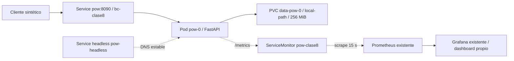

# UNLu — Lab Clase 8: caso integrador

Alumna: Silvia Andrea Gómez Villagra. Modalidad individual.
Preparación local del 01/11/2026; entrega de la consigna: 10/11/2026.
Este laboratorio es distinto del Trabajo Final (05/12/2026) y del Lab 7.

## Alcance y estado

Se conserva el template de la cátedra y se reutilizan `pow/`, su Dockerfile,
el chart `helm/charts/pow`, los workflows y la observabilidad existente.
Se inició el TODO de validación de cadenas y se reforzó `/mine` en la rama
`clase8/caso-integrador`. No hay commit, push, build Docker ni despliegue nuevo.

Las pruebas locales se ejecutaron por función, en procesos secuenciales y
directorios temporales independientes. Los resultados verificables y su plan
están en el directorio de evidencias `outputs/unlu-lab8-integrador`.
No se ejecutó una suite concurrente ni una prueba de carga.

## Arquitectura preparada

Este diagrama representa el despliegue previsto, no recursos creados.
Cada réplica futura tendrá su PVC. Con tres réplicas habrá tres cadenas
independientes: `PEERS` se inyecta, pero todavía no hay sincronización.
No se conectan wallets, redes Ethereum ni servicios del Lab 7.

## Archivos y aislamiento

| Archivo | Función | Estado |
|---|---|---|
| `namespace.yaml` | Namespace exclusivo `bc-clase8` | Preparado; no aplicado |
| `values-local.yaml` | Una réplica, imagen `unlu-lab8-pow:lab8-local`, política Never | Preparado; no construido ni desplegado |
| `values-three-nodes.yaml` | Etapa posterior de tres réplicas | Bloqueada por capacidad y autorización |
| `servicemonitor.yaml` | Selección exclusiva de servicios PoW en `bc-clase8` | Preparado; no aplicado |
| `dashboard-pow.json` | Copia del dashboard baseline, UID propio, filtro de namespace | Preparado; no importado |

Los manifests fueron revisados por lectura. Helm lint/template y validación
contra el API server siguen pendientes; no presento esa revisión como PASS.
El chart se reutiliza sin editarlo. Sus objetos namespaced reciben el namespace
de la release Helm: se deberá usar siempre `--namespace bc-clase8`.
No aplicar el archivo global `observability/servicemonitors.yaml`, pues incluye
otros servicios y selectores para todos los namespaces.

## Preparación y aceptación por etapas

1. Volver a medir Windows y el cgroup de k3d. Como criterio conservador propongo
   al menos 2 GiB libres en Windows y 1 GiB de margen real en k3d para habilitar
   el despliegue de tres pods. Son criterios operativos, no requisitos docentes.
   Comprobar también disco (<85 % ocupado según consigna), requests, presión
   de memoria y que no cambien los reinicios de los servicios anteriores.
2. Con autorización específica y capacidad, renderizar el chart existente con
   `values-k3s.yaml` más `labs/clase8/values-local.yaml`, release `pow`, namespace
   `bc-clase8`. Revisar una réplica, PVC local-path, puertos y política Never.
3. Solo cuando se autoricen builds: construir Linux/amd64 con la etiqueta
   exclusiva, importar al clúster `unlu-lab5-local` y verificar el runtime.
   No reemplazar imágenes, recursos o volúmenes de otros laboratorios.
4. Desplegar primero un nodo. Aceptación: Ready, PVC Bound con UID registrado,
   `/healthz`, `/tx`, `/mine` y `/chain`; guardar hash y altura por pod.
5. Solicitar autorización concreta antes de recrear `pow-0`. Comparar cadena,
   hash y UID de PVC antes/después. No borrar PVC ni namespace.
6. Incorporar únicamente el monitor de esta carpeta y el dashboard con UID
   propio, tras revisar el impacto sobre Prometheus/Grafana compartidos.
   Aceptación: target UP, tres bloques minados, altura creciente en Grafana.
7. Tres réplicas requieren nueva revisión de capacidad. Los requests suman
   192 MiB y los límites 768 MiB, sin contar infraestructura y caché. Cada PVC
   solicita 256 MiB (768 MiB en total). No confundir requests con RAM máxima.
   Al cambiar réplica/PEERS puede cambiar el template y recrearse `pow-0`;
   identificar ese efecto y solicitar autorización antes de aplicar.
8. Commit, PR y push requieren aprobación. Verificar los workflows de tests,
   build y publicación OIDC; no usar una clave JSON ni el tag latest.
   Terraform/GKE requieren presupuesto y autorización nuevos. El ensayo local
   está permitido por la consigna; no se rotulará como evidencia de GKE.

No se ofrecen comandos de limpieza automática: conservar datos y obtener
autorización concreta antes de eliminar o recrear cualquier recurso.

## Pruebas, errores y límites

`validate_chain` rechaza cadenas vacías, estructuras incorrectas, hash alterado,
PoW insuficiente, génesis distinto, índices y enlaces inválidos. La dificultad
sigue fija en 3; no se implementó aún consenso ni cambio de dificultad.
`/mine` mide duración, usa un único escritor y vacía el lote solo tras guardar.
Los errores de escritura simulados conservan archivo previo, mempool y altura.
Las pruebas de lock ocupado son secuenciales: no prueban carga concurrente.
La relectura del JSON no equivale a reiniciar un pod ni demuestra durabilidad
frente a apagados. No se validó Linux/amd64 ni el runtime del contenedor nuevo.

El timeout anterior se reprodujo en `asyncio._make_self_pipe` / `socket.accept`
al construir TestClient dentro del sandbox de Windows. La misma selección
pasó fuera de ese entorno. El supervisor nuevo limita el intérprete real,
guarda salida incremental y captura pila; no depende del launcher del venv.
Se reutilizaron bibliotecas instaladas sin cambiar ese entorno ni instalar
dependencias. Hay una advertencia de deprecación de AnyIO, sin fallo de test.

## Métricas propuestas para el Trabajo Final

- Duración de minado por bloque: evaluar dificultad y variabilidad del PoW.
- Peers alcanzables: distinguir nodos aislados de participantes conectados.
- Resultado y duración de sincronización: medir convergencia y errores.
- Tamaño del mempool: detectar acumulación de transacciones pendientes.
- Forks/reorganizaciones: estudiar desacuerdos y la regla de elección.

Estas métricas adicionales son propuestas; hoy se exporta `pow_block_height`.
`elapsed_seconds` está en la respuesta HTTP y logs, aún no en Prometheus.

## Borrador 8.4: plan de sincronización (10 líneas)

1. Mantendré una identidad DNS estable y un PVC independiente para cada nodo.
2. Empezaré sincronizando dos nodos antes de ampliar la red.
3. Usaré PEERS para descubrir direcciones y excluiré la propia.
4. Consultaré cadenas con timeout y límites de tamaño antes de procesarlas.
5. Validaré génesis, enlaces, índices, hashes y trabajo de cada candidato.
6. Elegiré la cadena válida con mayor trabajo acumulado verificable.
7. Desempataré de forma determinista por el hash de la punta, en orden lexicográfico.
8. Si agrego dificultad variable, verificaré la misma regla en todos los nodos.
9. Conservaré transacciones pendientes y evitaré duplicados tras una reorganización.
10. Probaré convergencia y recuperación antes de afirmar que hay consenso.

## Borrador 8.5: reflexión del avance (5 líneas)

Reutilicé la separación de entornos de IaC para preparar el namespace del laboratorio.
Tomé el Dockerfile y el pipeline OIDC como base; el build y la publicación siguen pendientes.
Preparé el uso de StatefulSet, PVC y observabilidad sin alterar los servicios anteriores.
La dificultad concreta fue el bloqueo de TestClient en el sandbox, que aislé con una pila de ejecución.
Aprendí a distinguir tests locales aprobados de despliegue, persistencia de pods y consenso todavía no verificados.
